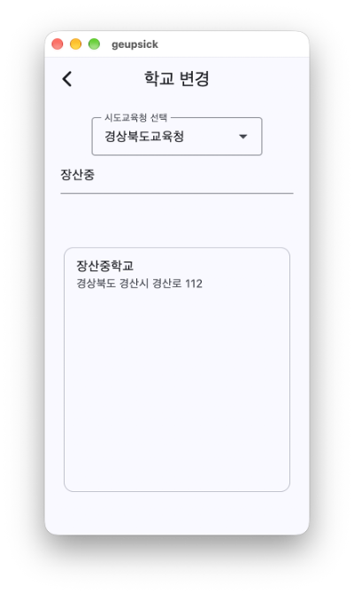
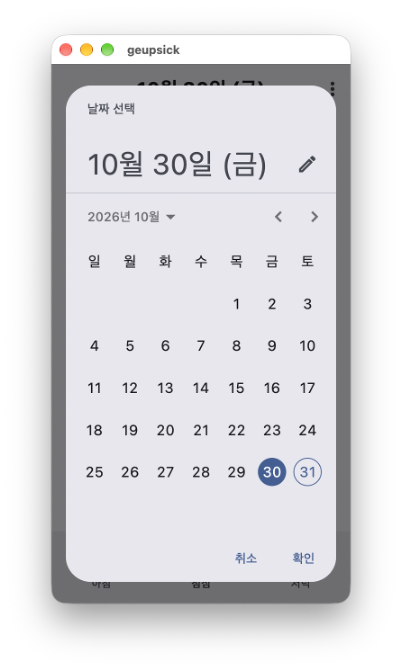
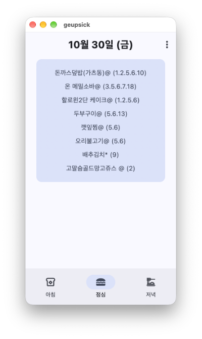
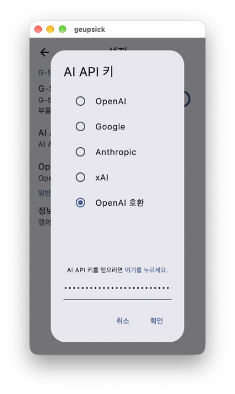
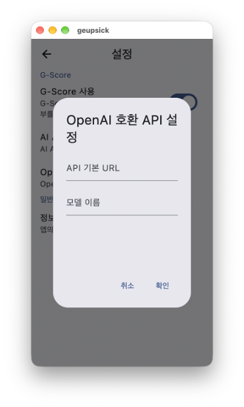
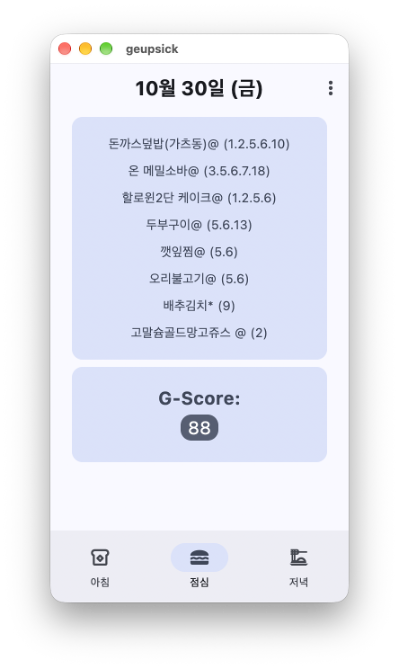

# geupsick

학교와 날짜를 선택해 급식 메뉴를 확인하고, AI 기반 G-Score를 산출하는 앱

## 주요 기능

| 기능           | 설명                                   |
| -------------- | -------------------------------------- |
| 학교 선택      | 시도교육청과 학교를 검색·선택          |
| 날짜·식사 선택 | 날짜와 아침 / 점심 / 저녁 메뉴 선택    |
| 메뉴 조회      | NEIS 급식정보 API에서 메뉴 데이터 요청 |
| G-Score        | 활성화 시 LLM으로 0–100 점수 산정      |

## 기술 스택

- Flutter

## 스크린샷

|   |  |
| :--------------------------------------------------: | :--------------------------------------------------: |
|                      학교 선택                       |                      날짜 선택                       |
|  |  |
|                      급식 메뉴                       |                    LLM 모델 설정                     |
|  |  |
|                 OpenAI 호환 API 설정                 |                       G-Score                        |
